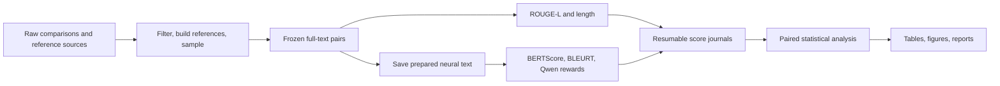

# Technical report: offline comparison of non-verifiable rewards

This report describes the current source and the completed 13 November 2026
Qwen3-4B experiment. The current scoring-source hash matches the hash recorded
by the GPU workers. The separate setup script has since been expanded to
consolidate installation and recovery commands; that does not change scoring.

The project evaluates **six rewards plus a length baseline** on pre-existing
preference pairs. It performs inference, comparison, and statistical analysis.
There is no policy training, optimizer, GRPO implementation, generated rollout
collection, LLM judge, or self-play in the current experiment.

**The implemented intrinsic reward is self-certainty, not self-consistency.**
Self-certainty examines a model's next-token distributions along one supplied
candidate. Self-consistency would require multiple generated responses and a
rule for measuring their agreement; that is not implemented here.

## 1. Code organization and execution flow

| Location | Responsibility |
| --- | --- |
| [`src/non_verifiable_rewards/data/loaders.py`](../src/non_verifiable_rewards/data/loaders.py) | Convenient three-column dataset loaders |
| [`src/non_verifiable_rewards/rewards/`](../src/non_verifiable_rewards/rewards) | One importable module per reward and a shared causal-LM scorer |
| [`experiments/data.py`](../src/non_verifiable_rewards/experiments/data.py) | Benchmark filtering, reference construction, deterministic sampling, preprocessing |
| [`experiments/assets.py`](../src/non_verifiable_rewards/experiments/assets.py) | Reference/checkpoint downloads and resolved model manifest |
| [`experiments/runner.py`](../src/non_verifiable_rewards/experiments/runner.py) | Model loading, scoring, diagnostics, sharding, and resumable workers |
| [`experiments/io.py`](../src/non_verifiable_rewards/experiments/io.py) | Configuration, hashes, source snapshots, atomic files, pair journals |
| [`experiments/analysis.py`](../src/non_verifiable_rewards/experiments/analysis.py) | Preference accuracy, uncertainty, correlations, coverage, exports |
| [`experiments/report.py`](../src/non_verifiable_rewards/experiments/report.py) | Figures, HTML/Markdown reports, LaTeX summary, artifact checksums |
| [`experiments/supplementary.py`](../src/non_verifiable_rewards/experiments/supplementary.py) | All paired comparisons, pilot overlap, truncation/weighting/threshold diagnostics |
| [`experiments/smoke.py`](../src/non_verifiable_rewards/experiments/smoke.py) | One-pair LM execution checks and the CPU pilot's restricted reporting scope |
| [`experiments/cli.py`](../src/non_verifiable_rewards/experiments/cli.py) | Command-line entry point and stage orchestration |
| `configs/`, `scripts/`, `requirements/` | Experiment settings, VM/Slurm launchers, recorded GPU dependencies |



The CLI exposes `prepare`, `download`, `preprocess`, `score`, `smoke`, `report`,
and `run`. Reporting reads saved scores and does not need GPU inference.

## 2. Dataset schema and what each field means

For notation, let `x` be a prompt, `y+` its preferred candidate, `y-` its rejected
candidate, and `r` a reference distinct from both candidates. Every method is
evaluated on the same frozen pairs, including reference-free methods.

| Field | Meaning and use |
| --- | --- |
| `dataset` | Reddit TL;DR or LitBench; keeps analyses separate |
| `prompt` | Source post/request; input to Qwen rewards |
| `preferred`, `rejected` | The two existing responses, oriented by the source preference label |
| `reference` | Independent comparison text for reference-dependent rewards |
| `prompt_id` | Groups comparisons of the same task for uncertainty estimates |
| `pair_id` | First 24 hexadecimal characters of a SHA-256 digest of dataset, prompt ID, preferred text, rejected text; used for joins, deduplication, resuming |
| `preferred_id`, `rejected_id` | Content-based candidate identifiers within a prompt |
| `reference_id` | Identifies the reference used for this comparison |
| `metadata` | Source row, source policy/confidence or upvotes, and reference-selection provenance |

Texts are stripped of surrounding whitespace. Empty prompts/candidates/references,
identical candidates, and a reference equal to either candidate are rejected.
The preferred/rejected orientation is used to evaluate the scores; the scorer
is never told which candidate won. Upvote counts, annotator confidence, and
source policy names do not enter the rewards or weight the primary accuracy.

The reference is not the preference label. It is an auxiliary text supplied to
metrics such as ROUGE-L and BERTScore. Taking the preferred candidate itself as
the reference would make those comparisons circular.

The convenience `load_sff()` and `load_litbench()` functions return only
`prompt`, `preferred`, `rejected`. They do not construct benchmark references
or apply all benchmark filters. The experiment preparation stage therefore
reads the richer raw sources and builds the schema above.

### Reddit TL;DR

The source is the **validation** comparisons of
`openai/summarize_from_feedback`, read through its Parquet conversion or a
cached Arrow file. A row's `choice` selects the preferred summary. Candidates
include outputs from existing summarization policies: human preference labels
do not imply that both candidate summaries were written by humans.

The reference is the original human TL;DR from OpenAI's
`tldr_3_filtered/valid.jsonl`, joined by post ID. The source post must match
after whitespace stripping. The benchmark excludes news examples, missing
references, mismatched source posts, malformed choices, empty/overlapping
texts, and duplicate labeled pairs. Its prompt has this format:

```text
SUBREDDIT: r/{subreddit}

TITLE: {title}

POST: {post}

TL;DR:
```

The recorded preparation audit starts with 86,086 source comparisons and keeps
36,093 eligible pairs from 5,821 prompts. The exclusion counts are 37,367
empty/overlapping-text cases, 7,950 duplicate labeled pairs, 2,285 missing
references, 107 post mismatches, and 2,284 non-Reddit cases. The combined
empty/overlap category should not be described as a more specific failure
without further inspection.

The GPU sample contains **2,000 pairs from 1,629 prompts**. One unordered
candidate pair appears with opposing human labels; the two source judgments
are retained because deduplication is of identical labeled pairs, not a
majority-vote reconciliation of conflicting labels.

### LitBench

The source is the **train** split of `SAA-Lab/LitBench-Train`. Using its train
split here does not train a model: it supplies an offline evaluation sample.
The labels are Reddit upvote preferences, a noisier proxy for quality than a
controlled assessment of two complete stories.

Preparation first groups exact stripped story texts by exact stripped prompt.
It then:

1. Requires at least three distinct stories for a prompt.
2. Requires the source row's chosen story to have strictly more upvotes than
   its rejected story.
3. Excludes both candidates from reference selection.
4. Chooses the remaining story with the highest maximum observed upvotes.
   Different observations of the same story can have different counts; their
   maximum is frozen, and a content hash breaks ties.
5. Removes invalid texts and duplicate labeled pairs.

The same reference is used for both candidates in a pair. Different pairs
for the same prompt can have different references because they exclude
different stories. A reference is held out from its own pair; it may appear
as a candidate in another pair. It is not necessarily better than either
candidate, and it is not a unique correct answer to a creative-writing prompt.

The source has 43,827 rows and 12,419 prompts. Restricting to at least three
stories leaves 37,866 rows from 6,459 prompts; removing 87 duplicate labeled
pairs leaves **37,779 eligible pairs**. The GPU sample contains **2,000 pairs
from 1,485 prompts**.

### Sampling and independence

Eligible pairs are sorted by `pair_id`, shuffled with `random.Random(1729)`,
and the first requested number are selected. This is uniform sampling of
eligible labeled pairs, not equal sampling of prompts. Repeated prompts and
stories are expected. Identical source inputs, filters, and seed make the
128-pair pilot a subset of the 2,000-pair run.

This nested design supports pipeline comparisons but is not a fresh
confirmatory test after using the pilot to choose settings. Source data and
selected pairs are saved with hashes in
[`data_manifest.json`](../outputs/eidf_qwen3_4b/data_manifest.json). For exact
reproduction, reuse those frozen files; upstream dataset branches can change.

## 3. Reward interface and inputs

Every reward has the same public batch API:

```python
scores = reward.score(candidates, references=references, prompts=prompts)
```

It returns one higher-is-better float per candidate, preserving order.
Optional supplied fields must have aligned lengths even when unused. Missing
required inputs and empty references raise errors. An empty candidate batch
returns an empty list. Imports do not load PyTorch, TensorFlow, Transformers,
or model weights; neural metrics initialize lazily and reuse their models.

| Reward | Actual scoring inputs | Model/implementation in the GPU run |
| --- | --- | --- |
| ROUGE-L | Candidate and reference | Google's `rouge-score`, stemming enabled |
| BERTScore | Candidate and reference | `bert-score` 0.3.13, RoBERTa-large layer 17 |
| BLEURT | Candidate and reference | Official TensorFlow BLEURT-20 |
| Self-certainty | Prompt and candidate | Qwen3-4B |
| Reference likelihood | Prompt, candidate, reference | Qwen3-4B |
| VR-CLI | Prompt, candidate, reference, plus a no-candidate baseline | Same Qwen3-4B |
| Length | Candidate | Whitespace-separated word count |

ROUGE-L, BERTScore, and BLEURT do not see the source prompt/post. Their evidence
about correctness comes through the reference. Self-certainty is reference-free
at scoring time, but it is evaluated on the same reference-eligible sample as
the other methods.

## 4. ROUGE-L

Source: [`rewards/rouge_l.py`](../src/non_verifiable_rewards/rewards/rouge_l.py).

Let `L` be the longest-common-subsequence length between the tokenized candidate
and reference. For nonempty token sequences of lengths `m` and `n`:

\[
P=L/m,\qquad R=L/n,\qquad
\operatorname{ROUGE\text{-}L}=\frac{2PR}{P+R}.
\]

The actual tokenizer, normalization, stemming, and zero-overlap behavior come
from Google's `rouge_score` library. The wrapper requests `rougeL` and returns
its `fmeasure`. It uses the complete supplied texts, not ROUGE-Lsum or a
sentence-level average. The reward is lexical overlap in the range [0, 1].

## 5. BERTScore

Source: [`rewards/bertscore.py`](../src/non_verifiable_rewards/rewards/bertscore.py).

The encoder creates contextual token embeddings for candidate and reference.
Ignoring the upstream library's padding/special-token bookkeeping, the core
calculation uses normalized embeddings `h_i` and `g_j`:

\[
P=\frac{1}{m}\sum_i\max_j h_i^\top g_j,\qquad
R=\frac{1}{n}\sum_j\max_i h_i^\top g_j,\qquad
F_1=\frac{2PR}{P+R}.
\]

Each token takes its best cosine-similarity match in the other text; this is
greedy matching, not an enforced one-to-one alignment or sentence-vector
cosine similarity. The wrapper returns the upstream F1 value.

GPU settings are `FacebookAI/roberta-large`, `num_layers=17`, `idf=False`,
and `rescale_with_baseline=False`. No IDF model is fitted to the benchmark and
no new metric is trained. Scores are similarity values, not probabilities of
human preference. Empty candidates receive the library's zero-F1 convention;
the benchmark's data validation excludes empty candidates anyway.

Each text is limited to **512 encoder tokens including special tokens**.
The wrapper checks lengths before upstream truncation. It rejects excess
length by default, but the experiment explicitly sets `allow_truncation=True`.
This is a major limitation on LitBench; see Section 10.

## 6. BLEURT

Source: [`rewards/bleurt.py`](../src/non_verifiable_rewards/rewards/bleurt.py).

The wrapper calls the official `BleurtScorer` with the explicit BLEURT-20
checkpoint. Its pretrained model jointly encodes reference and candidate and
returns its learned regression score. No BLEURT fine-tuning takes place on our
datasets. The raw score is higher-is-better but is not constrained to [0, 1]
and should not be interpreted as a preference probability.

Conceptually, the encoded input is a reference/candidate pair with three
special tokens. Its **combined** budget is 512 tokens. The official encoder
removes tokens from the end of the longer sequence until the combined content
fits into 509 tokens. The wrapper detects this condition in advance and either
rejects it or warns, according to `allow_truncation`.

The runtime uses a separate TensorFlow environment. A CUDA-configured worker
requires TensorFlow to detect a GPU and enables memory growth. The saved model
directory must be provided; there is no accidental fallback to BLEURT's small
bundled test checkpoint.

## 7. Self-certainty, and why it is not self-consistency

Sources: [`rewards/self_certainty.py`](../src/non_verifiable_rewards/rewards/self_certainty.py)
and [`rewards/causal_lm.py`](../src/non_verifiable_rewards/rewards/causal_lm.py).

For the supplied candidate tokens `y_1,...,y_T`, Qwen predicts at each position:

\[
p_t(v)=p_\theta(v\mid C(x),y_{<t}),
\]

where `C(x)` is the chat-formatted prompt and `v` ranges over the model's full
output vocabulary of size `V`. Let `U(v)=1/V`. The reward follows the
Intuitor-style **KL divergence in the direction uniform to model**:

\[
\begin{aligned}
s_t &= D_{\mathrm{KL}}(U\Vert p_t)\\
    &= -\log V-\frac{1}{V}\sum_{v=1}^{V}\log p_t(v),\\
R_{\mathrm{SC}}(x,y)&=\frac{1}{T}\sum_{t=1}^{T}s_t.
\end{aligned}
\]

A uniform next-token distribution scores zero. A distribution that differs
strongly from uniform scores higher. This is an unbounded concentration
statistic, not a calibrated estimate of correctness.

The implementation works directly with logits `z_t` using the equivalent,
numerically stable expression:

\[
s_t=\operatorname{logsumexp}(z_t)
       -\operatorname{mean}(z_t)-\log V.
\]

Conceptual pseudocode for the target positions is:

```python
logits = target_prediction_logits.float()
per_position = (
    torch.logsumexp(logits, dim=-1)
    - logits.mean(dim=-1)
    - math.log(logits.shape[-1])
).clamp_min(0)
reward = per_position.mean()
```

The real scorer performs the reduction in chunks and uses double precision
for summing the per-position values. The clamp prevents small negative values
caused by numerical roundoff. All output-logit vocabulary dimensions are used;
there is no top-k restriction, sampling temperature, or nucleus filtering.

**Teacher forcing** means that the model receives the actual saved candidate
prefix, including any words Qwen itself would not have generated. It can
compute all required positions in one causal forward pass per sequence.
Only positions predicting candidate tokens contribute to the average; prompt
and padding positions do not.

This differs from three other quantities:

| Quantity | Calculation | Present as a benchmark reward? |
| --- | --- | --- |
| Implemented self-certainty | Mean `KL(U || p_t)` over candidate positions | Yes |
| Candidate log-likelihood | Mean `log p_t(y_t)` for the observed candidate tokens | No |
| Negative entropy | Mean `sum_v p_t(v) log p_t(v)` | No |
| Self-consistency/consensus | Agreement among multiple sampled responses to the same prompt | No |

In particular, the current observed token `y_t` is not selected from the
distribution to calculate `s_t`; it affects subsequent predictions through
the prefix. A low-probability observed token can therefore occur at a position
with high self-certainty. Because no EOS is appended, there is also no extra
position checking the prediction after the final candidate token.

For a two-token vocabulary, `[0.5, 0.5]` gives zero, whereas `[0.99, 0.01]`
gives approximately 1.614 nats, regardless of which token is observed at that
particular position. This illustrates why self-certainty is not candidate
likelihood or an explicit quality judgment.

There is no reference, second candidate, upvote count, or human preference
label in this computation. Averaging over candidate positions reduces direct
length scaling but does not guarantee freedom from length or style bias.
Because these candidates are supplied rather than generated by this run,
their logits are not already available: self-certainty costs forward inference.

To implement actual self-consistency later, the pipeline would need to sample
multiple responses per prompt, save the sampling settings and outputs, define
an agreement function suitable for free text, and compare that new reward
against the human labels. Majority voting on exact strings is not a suitable
default for different valid creative stories. No such method is currently
substituted for self-certainty.

## 8. Reference likelihood and VR-CLI

The [methodology audit](methodology_audit.md) independently verifies the saved
calculations and reference provenance against primary sources. The core VR-CLI
formula matches the paper; completed-candidate conditioning and our LitBench
reference proxy change the task. The generic log-probability reward below is
not RLPR's mean-token-probability reward or a reproduction of VeriFree training.

Sources: [`rewards/reference_likelihood.py`](../src/non_verifiable_rewards/rewards/reference_likelihood.py),
[`rewards/vr_cli.py`](../src/non_verifiable_rewards/rewards/vr_cli.py),
and [`experiments/runner.py`](../src/non_verifiable_rewards/experiments/runner.py).

### Conditioning and raw likelihood

The experiment constructs a user message containing the source prompt followed
by the literal text:

```text
Use this candidate response as context:
{candidate}
```

It passes that message to Qwen's tokenizer with:

```python
tokenizer.apply_chat_template(
    [{"role": "user", "content": content}],
    tokenize=False,
    add_generation_prompt=True,
    enable_thinking=False,
)
```

The reference is then scored as the assistant continuation. It is not inserted
into the user message. Define the conditioned mean reference log probability:

\[
L_y=\frac{1}{M}\sum_{t=1}^{M}
\log p_\theta(r_t\mid C(x,y),r_{<t}).
\]

The benchmark's `reference_likelihood` reward is `L_y`. Higher means less
negative and more probable. The scored target is the **reference**, not the
candidate and not the combined input sequence.

The importable `ReferenceLikelihoodReward` defaults to a sum; the experiment
explicitly uses a mean. Both give the same within-pair ranking because the
reference token sequence and length `M` are identical for both candidates.
The runner retains the mean, reference-token count, and a reconstructed sum
(`mean * token_count`).

This is an adaptation of plan-conditioned likelihood rewards: the finished
summary/story occupies the position of a plan. We do not generate reasoning
traces, assess plan quality separately, or train a policy. Policy and frozen
scorers coincide here because there is one unchanged checkpoint and one
inference configuration.

### VR-CLI baseline, transformation, and thresholds

The no-candidate baseline uses the same prompt/chat template without the
candidate section:

\[
L_0=\frac{1}{M}\sum_{t=1}^{M}
\log p_\theta(r_t\mid C(x),r_{<t}).
\]

The percent improvement in reference perplexity is:

\[
I=100\frac{\exp(-L_0)-\exp(-L_y)}{\exp(-L_0)}
 =100\left[1-\exp(L_0-L_y)\right].
\]

The code evaluates `-100 * math.expm1(L_0 - L_y)` for numerical stability.
It does not exponentiate summed sequence log probabilities. An extreme
regression that overflows the exponential is treated as negative infinity
for thresholding; its diagnostic value is saved as null with an overflow flag.

| Perplexity improvement `I` | VR-CLI reward |
| --- | ---: |
| `I < 0.05` | 0 |
| `0.05 <= I < 1` | 0.5 |
| `1 <= I < 2` | 0.9 |
| `I >= 2` | 1 |

The cutoffs are **percent units**: `0.05` means 0.05%, not 5%. Threshold
equality enters the higher bucket using `bisect_right`. This implements the
paper's thresholded perplexity-improvement variant, not a clipped log-probability
difference. Custom thresholds and nondecreasing levels are supported.

Within a pair, both candidates share `L_0`, so thresholding is a monotone
transformation of their raw likelihoods. It can create ties but cannot reverse
their mathematical ordering. The supplementary analysis checks for actual
ranking reversals; the completed run has none. Absolute tie tolerances can
also classify extremely small continuous margins as ties.

### Shared computation and caching

The LM worker calls `CausalLMScorer` directly for both likelihood and
self-certainty, and calls `VRCLIReward.score_from_log_likelihoods` to reuse
the computed likelihoods. It does not load three copies of Qwen.

For one pair, at the configured LM batch size of one, the work is normally:

1. One reference-under-prompt sequence, unless its baseline is cached.
2. Two reference-under-prompt-and-candidate sequences.
3. Two candidate-under-prompt sequences for self-certainty.

VR-CLI's thresholding adds no further model call. Baselines are persisted
per worker shard and keyed by a digest of the exact no-candidate context and
reference text. Worker identity checks bind that cache to the run's model and
scoring settings. The GPU run saved 3,227 unique baseline evaluations across
4,000 pairs.

The public `VRCLIReward.score()` API has a narrower cache policy: it deduplicates
baselines within one call and does not keep them across calls, allowing callers
to use a scorer whose weights might change. The experiment's persistent cache
is appropriate only because its scorer stays fixed.

## 9. Shared causal-LM implementation

The GPU run loads `Qwen/Qwen3-4B` with `dtype=bfloat16`, CUDA, and SDPA attention.
It runs `model.eval()` under `torch.inference_mode()`, with `use_cache=False`.
There is no dropout during scoring, no gradient calculation, and no decoding.

The effective context limit is the minimum of the explicit limit, the
tokenizer's meaningful finite limit, and the model's maximum positional
length. The experiment requests 32,768 tokens.

Token alignment is handled explicitly:

- Context and continuation are tokenized separately with
  `add_special_tokens=False`, then concatenated. This preserves identical
  reference target IDs with and without candidate conditioning, even where
  joint tokenization could merge tokens across the boundary.
- A BOS token is prepended when available and not already present. An empty
  context can fall back to EOS solely as a prefix token.
- No EOS is appended to the target. These are probabilities/statistics for
  observed continuation tokens, not a separately scored stopping decision.
- The logits at sequence position `t-1` predict token `t`. The slice includes
  the prediction of the first target token and excludes context-only positions.
- Batches use local right padding and attention masks. Padding positions do
  not contribute to the score, and the tokenizer's padding configuration is
  not modified globally.
- Overlength or empty targets raise errors before inference. The scorer does
  not silently shorten a target or switch to sliding windows.

For memory efficiency, models exposing `logits_to_keep` project only positions
needed to predict continuations. Other models return all logits. The scorer
then reduces target logits in blocks of 128 positions, upcasts each block to
float32, computes `logsumexp`, and sums the resulting values in float64.
This reduction chunking does **not** split the model's context: the transformer
still sees the full input sequence in its forward pass.

Likelihood selects the observed target's logit and subtracts `logsumexp`.
Self-certainty averages logits over the vocabulary instead. Natural logarithms
are used throughout. The final scalar is validated as finite.

The public reward classes default to simple plain-text context builders;
they do not automatically select the experiment's Qwen chat template. To
reproduce benchmark scores through the public API, supply the same context
builders, checkpoint, tokenizer, dtype, and token policy as the runner.

## 10. Input lengths and known truncation

There are two separate mechanisms:

1. **Explicit preprocessing:** limits on prompt, candidate, and reference
   lengths measured with the Qwen tokenizer. If enabled, only the first `N`
   tokens are decoded back to text. Original text remains in `data/` and
   prepared text/counts are saved in `scored_text/`.
2. **Native encoder limits:** BERTScore and BLEURT tokenize that prepared text
   with their own tokenizers and may truncate again. Their token budgets have
   no connection to Qwen's configured context window.

The GPU run sets all three explicit preprocessing caps to zero, meaning full
supplied text. Qwen rejects overlength inputs instead of truncating; none
occurred in this run. ROUGE-L and length always use original full texts,
including in the CPU pilot.

| GPU-run truncation | Reddit TL;DR | LitBench |
| --- | ---: | ---: |
| Qwen rewards, ROUGE-L, length | None | None |
| BERTScore candidate evaluations affected | 0 / 4,000 | 3,492 / 4,000 (87.30%) |
| BERTScore pairs with any affected evaluation | 0 / 2,000 | 1,846 / 2,000 (92.30%) |
| BLEURT candidate evaluations affected | 0 / 4,000 | 3,829 / 4,000 (95.73%) |
| BLEURT pairs with any affected evaluation | 0 / 2,000 | 1,952 / 2,000 (97.60%) |

An affected evaluation can lose candidate text, reference text, or both.
All 2,000 pairs were still scored by every method; these are shortening counts,
not dropped-example counts. The LitBench encoder results describe comparisons
of truncated inputs against preferences over complete stories. They should
not determine the value of full-story semantic metrics without further work.

Native encoder lengths and flags are stored with scores. `scored_text/`
contains prepared strings **before** this native truncation, not a dump of
the final encoder input tensors. Reconstructing those tensors requires the
recorded tokenizer/backend. No full-story chunk aggregation or long-context
encoder variant is currently implemented.

## 11. Preference comparison, uncertainty, and correlations

Source: [`experiments/analysis.py`](../src/non_verifiable_rewards/experiments/analysis.py).

For reward `k` and pair `i`, the margin is:

\[
d_{ik}=R_k(x_i,y_i^+,r_i)-R_k(x_i,y_i^-,r_i).
\]

Inputs unused by a reward are omitted from its actual calculation. With
`epsilon = 1e-7`, preference credit is:

\[
a_{ik}=\begin{cases}
1 & d_{ik}>\epsilon,\\
0 & d_{ik}<-\epsilon,\\
0.5 & |d_{ik}|\leq\epsilon.
\end{cases}
\]

Accuracy is the mean credit over pairs. A tie earns half credit; it is neither
dropped nor counted as a full success. This is an absolute, common tolerance,
not one calibrated to each reward's scale. No reward scores are fitted,
rescaled, or combined into an ensemble.

The length baseline returns `float(len(candidate.split()))`; thus the pair
comparison chooses the candidate with more whitespace-separated words and
ties on equal counts. The public module also supports character count, but
the benchmark uses words.

All primary comparisons use the common set with finite, successful scores
for both candidates across all included rewards. Missing required records or
unexpected/duplicate records cause reporting to fail. Explicit error records
are retained, reported, and excluded through the common-complete-set rule.
The full GPU run has no errors or exclusions at this stage.

### Bootstrap intervals

The 2,000 pairs are not assumed independent because some share prompts,
candidates, and references. The bootstrap therefore samples **prompt groups**
with replacement, keeping all pairs in each selected group. For each of
10,000 replicates, it computes total pair credit divided by total sampled
pair count. The main estimand remains pair-weighted accuracy.

The same prompt draws are used for every reward. The 2.5th and 97.5th
percentiles yield the 95% interval. Differences from length, and supplementary
differences between any two methods, are calculated within each shared
replicate. Overlap of separate accuracy intervals is not the test used to
compare methods.

Intervals are exploratory and not corrected for multiple comparisons.
The supplementary equal-prompt-weight estimate first averages within each
prompt and then across prompts; it addresses a different weighting choice.

### Redundancy and diagnostics

- Spearman correlations compare **within-pair score margins**. This avoids
  directly correlating raw values with incompatible scales and prompt/reference
  difficulty. It does not completely remove length or reference-choice effects.
- Decision agreement compares the three outcomes: preferred wins, tie,
  rejected wins. Two methods can agree because both are wrong.
- Constant rewards have undefined correlation, recorded/displayed as such.
- Length diagnostics separate pairs where the preferred output is shorter,
  equal in word count, or longer.
- VR-CLI diagnostics examine continuous improvements, reward levels, ties,
  and loss of correct/incorrect raw decisions through thresholding.
- Qualitative examples select up to six pairs per dataset with the most evenly
  split correct/incorrect non-length decisions. Stable pair IDs break ties.
  These are deliberately selected disagreements, not a random qualitative sample.

The supplementary module also compares pilot/full-run scores on overlapping
pairs, checks that ROUGE-L/length are unchanged there, and separates native
encoder-truncation subgroups. Those subgroups contain different examples;
their accuracy difference is not a causal estimate of truncation's effect.

## 12. Worker execution, resuming, and provenance

There are four worker backends: `lexical` produces ROUGE-L and length;
`bertscore` and `bleurt` each produce one reward; `lm` produces all three Qwen
rewards. Models are loaded only when a worker finds pending pairs and are
reused across both datasets.

The worker currently iterates one pair at a time. Encoder `batch_size=8` is
an upper bound passed to the libraries; it does not collect eight benchmark
pairs into one call. Qwen's batch size is one. This prioritizes straightforward
resuming and bounded memory over maximal throughput.

Each completed pair is one JSONL journal record, containing all scores for
that backend, both candidates, timings, and completion time. Appends call
`flush()` and `os.fsync()`. A nonblocking exclusive file lock prevents two
workers from writing the same journal simultaneously. On resume:

- Completed pair IDs are skipped, including recorded failures.
- An incomplete final line is truncated and can be recomputed.
- Malformed complete lines and duplicate pair IDs raise errors.
- Existing failures are not silently retried or replaced with fabricated scores.

If scoring a pair raises an exception, all candidate/reward rows for that
backend/pair are written as errors, with null scores and a traceback. A model
load failure can stop the worker before pair scoring. The EIDF launcher still
attempts the other backends and records failures.

Sharding assigns `pairs[shard_index::num_shards]`. The Slurm template maps a
12-task array to three neural backends times four shards. The EIDF run instead
used one shard per backend on one A100: lexical scoring ran alongside Qwen,
then BERTScore and BLEURT ran sequentially in separate processes.

Resume identity includes configuration hash, scoring-source hash, resolved
model identifiers/revisions or checkpoint hash, original-data manifest hash,
prepared-text manifest hash, backend, and shard numbering. Original/prepared
data file hashes are checked before scoring. Changing a guarded identity
requires a new run directory.

Scoring-source hashing covers reward modules, the runner, data preparation,
and shared experiment I/O. Reporting/interpretation changes can therefore be
made without changing scored results. Package versions are recorded for each
invocation, but are **not themselves a resume-identity check**; use the pinned
environments and a separate run when changing dependencies. Hash guards do not
promise bitwise reproducibility across arbitrary GPU/software configurations.

Model names requesting `main` are resolved once to immutable revisions and
stored in `models.json`; subsequent downloads reuse those recorded revisions.
The BLEURT archive has a recorded SHA-256. Initial environment and source
snapshots, per-invocation package/memory records, and output-file checksums
provide additional provenance.

## 13. Configurations, hardware, and saved outputs

| Setting | CPU pilot | Completed EIDF run |
| --- | --- | --- |
| Pairs per dataset | 128 | 2,000 |
| LM | Qwen3-0.6B | Qwen3-4B |
| LM precision | Float32 with dynamic int8 linear layers | bfloat16; no int8 |
| BERTScore | DistilBERT layer 5 | RoBERTa-large layer 17 |
| BLEURT | BLEURT-20-D3 | BLEURT-20 |
| Explicit prompt/candidate/reference caps | 384 / 192 / 192 Qwen tokens | Disabled |
| LM context limit | 2,048 | 32,768 |
| Bootstrap replicates | 2,000 | 10,000 |
| Primary LM results | Excluded; execution check/partial records retained | Complete |

The pilot's `evaluation_scope.json` prevents partial LM records from entering
primary accuracy/correlation/cost comparisons. A saved successful smoke pair
can be reused without loading Qwen. The pilot remains at Git tag
`cpu-pilot-128-pairs`; it is not a complete Qwen3-0.6B accuracy benchmark.

The completed GPU run used NVIDIA A100-SXM4-40GB, Python 3.12.16, PyTorch
2.9.1+cu128, Transformers 5.22.2, and TensorFlow 2.21.0. Fast working environments
and weights were under `/root`. Results were written directly under
`/workspace/writeable/non-verifiable-rewards/outputs/qwen3_4b_20261113`.
Model backups and setup recovery materials are persistent sibling directories.
The local results mirror is `outputs/eidf_qwen3_4b/`.

| Saved artifact | What it enables |
| --- | --- |
| `data/*.jsonl`, `*.parquet` | Recover the complete sampled text, labels, references, identities, and metadata |
| `scored_text/*.jsonl`, `preprocessing.json` | Recover prepared text and original/prepared lengths |
| `scores/<backend>/*.jsonl` | Resume or audit raw per-pair scoring |
| `scores/lm/*.baselines.jsonl` | Recover reused prompt/reference baseline likelihoods |
| `scores/*/*.metadata.json`, `*.invocation-*.json` | Inspect worker identity, package versions, timing, errors, and memory |
| `tables/candidate_scores.*` | All 56,000 scalar candidate/reward records |
| `tables/pair_margins.*` | Per-pair reward differences and preference credit |
| `tables/summary.*`, `bootstrap_accuracy.*` | Accuracy, tie rates, confidence intervals, saved bootstrap replicates |
| `tables/*spearman.csv`, `*decision_agreement.csv` | Reward redundancy comparisons |
| `tables/coverage.*`, `failures.*`, `length_diagnostics.*` | Completion, text coverage, failures, length associations |
| `tables/all_paired_comparisons.*`, other supplementary tables | Paired method differences, pilot overlap, weighting/truncation/threshold sensitivity |
| `tables/pair_timings.*`, `runtime.*`, `workers.*` | Per-pair inference time and separate worker/load overhead |
| `tables/disagreement_examples.jsonl` | Selected full-text qualitative cases |
| `report.html`, `report.md`, `tables/summary.tex` | Readable and publication-oriented exports |
| `figures/*.png`, `*.pdf` | Eight exported figures |
| `config.json`, `models.json`, `environment.json`, `source_at_*.tar.gz` | Configuration, resolved assets, initial environment, source snapshots |
| `artifacts.json` | File sizes and SHA-256 checksums after report generation |

The pipeline saves scalar scores and aggregate LM statistics, not every token's
logits, embedding, or probability distribution. Per-position analyses would
require further inference. LM diagnostic fields are attached to rows for all
three LM rewards for convenience; their presence on a self-certainty row does
not mean the reference was used to compute that score.

Pair timing starts after model loading and ends before the pair's journal
append, while worker wall time includes loading and output overhead. Runtime
tables combine the three LM rewards in one backend; their shared computation
must not be counted three times. In the original run, the full pipeline took
33 minutes 46 seconds excluding setup/downloads; the LM worker took 23.25
minutes and peaked at 8.77 GiB of PyTorch-allocated GPU memory.

## 14. Validation and interpretation boundaries

The tests use analytic distributions and tiny local models to check causal
shifting, target-only masking, padding, BOS/EOS behavior, low-precision
reductions, the direction of the self-certainty KL, and selective-logit
projection. Other tests cover known ROUGE results, BLEURT/BERTScore calls,
reference selection, seeded nesting, VR-CLI thresholds/overflow/baseline
deduplication, journal recovery, reporting scope, and overlapping/missing shards.

During the GPU run the main environment recorded 60 passed / 1 skipped, and
the BLEURT environment recorded 48 passed / 4 skipped. Optional dependencies
explain the differing coverage. Actual GPU matrix operations were also checked
in both frameworks. Final validation verified 56,000 unique finite scores,
2,000 common pairs per dataset, zero scoring errors, and 101 artifact hashes
both remotely and in the local mirror. This documentation update does not
change the frozen outputs.

Current accuracy point estimates are:

| Reward | Reddit TL;DR | LitBench |
| --- | ---: | ---: |
| ROUGE-L | 57.48% | 52.38% |
| BERTScore | 56.80% | 56.15% |
| BLEURT | 57.30% | 50.75% |
| Self-certainty | 60.30% | 61.45% |
| Reference likelihood | 44.25% | 49.90% |
| VR-CLI | 47.70% | 50.08% |
| Length | 54.33% | 50.33% |

Self-certainty has the best point estimate and beats length on both datasets.
Its Reddit advantage over ROUGE-L has a paired interval narrowly including
zero. LitBench encoder results remain truncated-input baselines. VR-CLI ties
on 73.10% of Reddit pairs and 70.75% of LitBench pairs; its apparent increase
over raw likelihood mostly reflects replacement of decisions with half-credit
ties. Full uncertainty estimates and interpretation are in the
[experiment analysis](../outputs/eidf_qwen3_4b/analysis.md).

The present experiment establishes offline association with these existing
labels under these model/input choices. It does not demonstrate reward-hacking
resistance, RL improvement, full-story encoder quality, or the performance of
self-consistency. Those require separate experiments and, for self-consistency
and full-story encoder variants, additional implementation.
