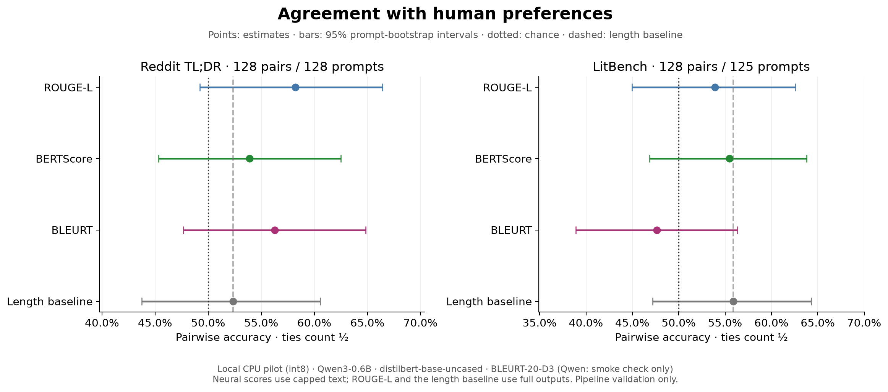
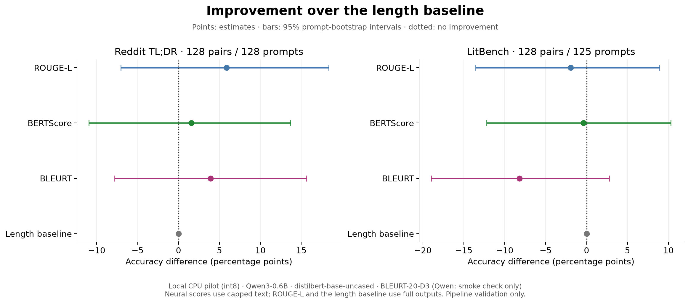
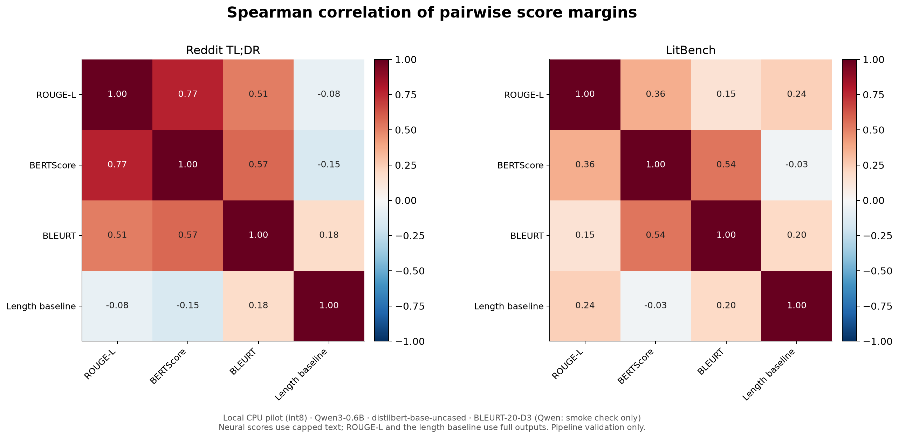
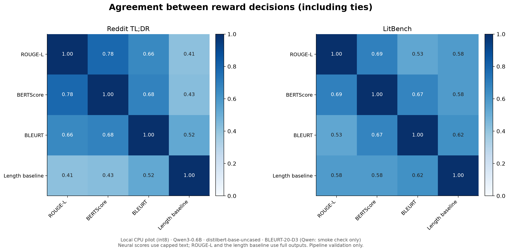
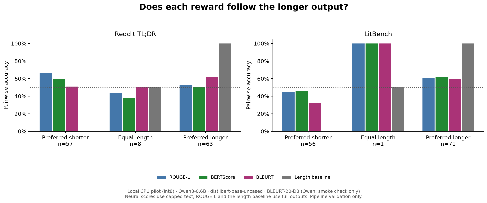
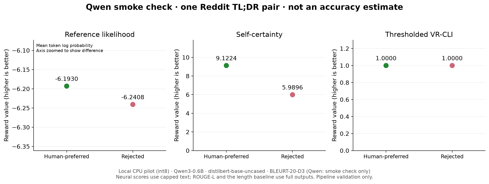
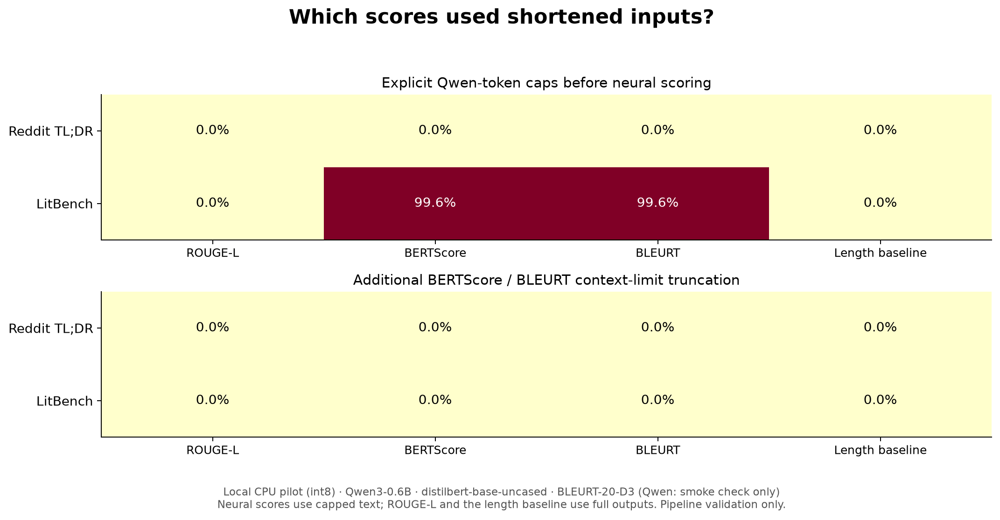
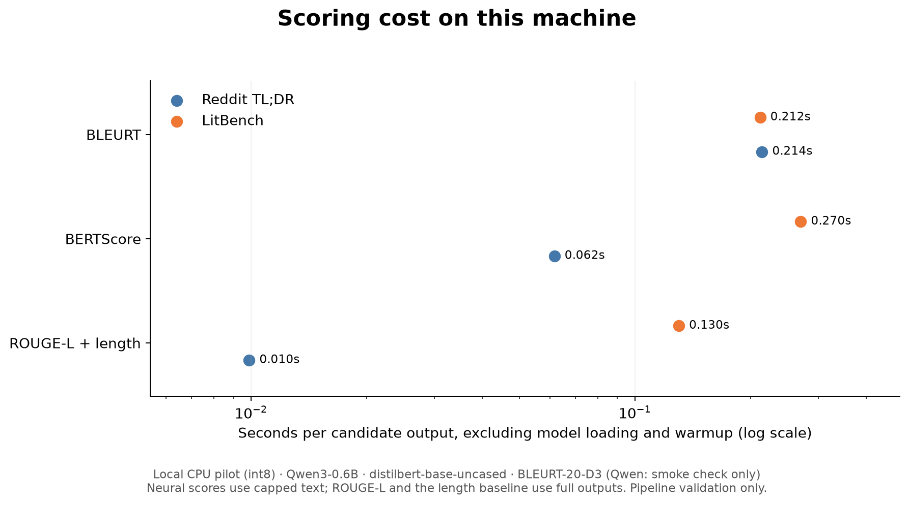

# Local CPU pilot (int8)

lm: Qwen/Qwen3-0.6B; bertscore: distilbert/distilbert-base-uncased; bleurt: BLEURT-20-D3 (Qwen smoke check only; excluded from benchmark accuracy)

- CPU PILOT: small checkpoints, 128 pairs per dataset, and capped neural inputs. Validate the pipeline and figures; do not treat these as Qwen3-4B or full-story benchmark results.
- Qwen is excluded from the primary benchmark because local LM evaluation was limited. One successful pair is displayed as an execution smoke check. Any partial LM outputs are retained but excluded from accuracy, correlations, and cost comparisons. See evaluation_scope.json for the saved scope.
- This is an offline preference comparison. There is no training or output generation.
- Each reward scores both members of the same pair. A higher human-preferred score earns 1, a lower score earns 0, and a tie earns 0.5.
- Accuracy uses pairs completed by every reward included in the primary benchmark. The 95% percentile bootstrap intervals resample prompts, preserving dependent pairs and paired differences versus length. Intervals are exploratory and not adjusted for multiple comparisons.
- Reddit references are original human TL;DRs joined by post ID with matching post text. Pairs containing the reference itself are excluded. LitBench references are the highest-upvote distinct story outside the pair; maximum observed upvotes resolve varying scraped counts.
- The length baseline counts full-output words. ROUGE-L uses full texts. Neural scores use the saved scored_text/ inputs and may undergo additional encoder truncation. Human preferences refer to the full original outputs.
- Prompt ≤ 384 Qwen tokens; candidate ≤ 192; reference ≤ 192 (zero means unlimited).
- Reference likelihood uses mean reference-token log probability. VR-CLI reuses it and the no-candidate baseline, applying the paper's percent-perplexity thresholds. Policy and frozen scorers coincide here because they share the same checkpoint.
- Correlations use preferred-minus-rejected score margins; decision agreement separately measures matching win/tie/loss decisions. n/a means correlation is undefined for a constant reward. High correlation alone does not establish redundancy or RL robustness.
- The local Qwen linear layers use PyTorch dynamic int8 quantization; score reductions remain float32. Quantization is disabled in the GPU configuration.

## Results

| Dataset | Reward | Accuracy (95% CI) | Δ vs length (95% CI), pp | Ties | Pairs |
| --- | --- | --- | --- | --- | --- |
| Reddit TL;DR | ROUGE-L | 58.2% [49.2%, 66.4%] | +5.9 [-7.0, +18.4] | 0.8% | 128 |
| Reddit TL;DR | BERTScore | 53.9% [45.3%, 62.5%] | +1.6 [-10.9, +13.7] | 0.0% | 128 |
| Reddit TL;DR | BLEURT | 56.2% [47.7%, 64.8%] | +3.9 [-7.8, +15.6] | 0.0% | 128 |
| Reddit TL;DR | Length baseline | 52.3% [43.8%, 60.5%] | +0.0 [+0.0, +0.0] | 6.2% | 128 |
| LitBench | ROUGE-L | 53.9% [45.0%, 62.6%] | -2.0 [-13.6, +8.9] | 0.0% | 128 |
| LitBench | BERTScore | 55.5% [46.9%, 63.8%] | -0.4 [-12.2, +10.3] | 0.0% | 128 |
| LitBench | BLEURT | 47.7% [38.9%, 56.3%] | -8.2 [-19.0, +2.8] | 0.0% | 128 |
| LitBench | Length baseline | 55.9% [47.2%, 64.3%] | +0.0 [+0.0, +0.0] | 0.8% | 128 |

- Reddit TL;DR: highest point estimate is ROUGE-L (58.2%). No reward's paired 95% interval lies entirely above the length baseline.
- LitBench: highest point estimate is Length baseline (55.9%). No reward's paired 95% interval lies entirely above the length baseline.

## Preference agreement

[PDF](figures/pairwise_accuracy.pdf)

## Paired differences from length

[PDF](figures/accuracy_vs_length.pdf)

## Reward-margin correlations

[PDF](figures/reward_correlations.pdf)

## Decision agreement

[PDF](figures/decision_agreement.pdf)

## Length effects

[PDF](figures/length_diagnostics.pdf)

## Qwen: one-pair execution check

[PDF](figures/qwen_smoke_check.pdf)

## Input shortening

[PDF](figures/input_coverage.pdf)

## Runtime

[PDF](figures/runtime.pdf)

## Saved outputs

Full original pairs: `data/`. Exact neural inputs: `scored_text/`. Resumable pair journals: `scores/`. Flat scores, margins, confidence intervals, bootstrap replicates, coverage and timing tables: `tables/` (CSV and Parquet). Config, resolved model revisions, source hashes, environment and logs are retained.
